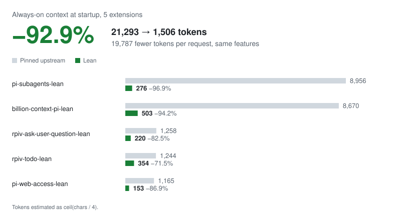

<div align="center">

# My Lean Pi Setup

**Your Pi, batteries included. Same power, less drain.**

Lean versions of 5 popular Pi extensions, plus an `AGENTS.md` template.<br>
Same features, same quality, a fraction of the always-on context.

[简体中文](README.zh-CN.md)

<br>



</div>

## Why

This is the [Pi coding agent](https://github.com/earendil-works/pi) setup I use every day. The goal is simple: send less useless context with every request. Fewer tokens means lower cost, and the model can focus on what matters, so it works smarter. The repo has three parts:

* **Lean versions of 5 popular extensions**: same features, much shorter tool prompts.
* **2 companion tools**: for the base prompt and seeing where tokens go.
* **An `AGENTS.md` template**.

## Getting started

1. Install [`pi-context-view`](#pi-context-view) and check your current token usage so you have a baseline:

   ```bash
   pi install npm:pi-context-view
   ```

2. Shorten Pi's own base prompt with [`pi-docs-slim`](#pi-docs-slim). This one trims Pi itself, not an extension:

   ```bash
   pi install npm:@ssk_dev/pi-docs-slim
   ```

3. Install the [lean extensions](#lean-extensions) you need:

   ```bash
   pi install npm:@ssk_dev/pi-subagents-lean
   pi install npm:@ssk_dev/pi-web-access-lean
   pi install npm:@ssk_dev/rpiv-ask-user-question-lean
   pi install npm:@ssk_dev/rpiv-todo-lean
   pi install npm:billion-context-pi-lean    # or pi-blackhole; see Long-context management
   ```

4. Measure again with `pi-context-view` to see what you saved.

Keep in mind:

* Configuration details live in each repo's README.
* Install either the original extension or its lean version, not both; loading both registers the same tools twice.

## Companion tools

| Area | Tool | What it does |
| --- | --- | --- |
| Base prompt | [pi-docs-slim](#pi-docs-slim) | Drops the built-in documentation guidance |
| Usage view | [pi-context-view](#pi-context-view) | Shows how many tokens each part uses |

### pi-docs-slim

[pi-docs-slim](https://github.com/kunkun9527/pi-docs-slim) makes Pi's built-in documentation guidance load only when needed (ask with `/pi`), so the base prompt gets shorter. It's my fork of Rob Zolkos's [pi-slim](https://github.com/robzolkos/pi-slim), updated to work on Pi 0.87.1; the original no longer removes the docs there.

```bash
pi install npm:@ssk_dev/pi-docs-slim
```

### pi-context-view

[pi-context-view](https://github.com/dimk90/pi-context-view) shows where your tokens go: base prompt, tools, extensions, and messages. It only measures; it doesn't compress anything.

```bash
pi install npm:pi-context-view
```

## Lean extensions

Many great Pi extensions ship long tool descriptions that get sent with every request, eating tokens before the conversation even starts. The lean versions mainly change what the model sees: tool schemas, descriptions, and injected prompts are cut down to what's actually needed.

| Extension | What it does | What was trimmed |
| --- | --- | --- |
| [pi-subagents-lean](https://github.com/kunkun9527/pi-subagents-lean) | Hands tasks to subagents that can run in the background and be redirected mid-task | Start, fetch results, and redirect merged into one `subagent` tool; agent discovery and lifecycle kept |
| [pi-web-access-lean](https://github.com/kunkun9527/pi-web-access-lean) | Searches the web, checks claims, fetches pages, pages through long results | Four tools merged into one `web_access`; advanced options in on-demand help |
| [rpiv-ask-user-question-lean](https://github.com/kunkun9527/rpiv-ask-user-question-lean) | Asks multiple-choice questions when a requirement or decision is unclear | Repeated wording removed; question UI and option validation unchanged |
| [rpiv-todo-lean](https://github.com/kunkun9527/rpiv-todo-lean) | Breaks work into tasks, tracks dependencies and progress | Shorter, flatter schema; no task features dropped |
| [billion-context-pi-lean](https://github.com/kunkun9527/billion-context-pi-lean) | Compresses older conversation into summaries and restores details on demand, keeping long sessions in a small context | 8 tools cut to `compress` and `acp_context` (subagent delegation removed); the always-on prompt keeps only the rules needed before a call |

### Context used at startup

<!-- token-benchmark:aggregate:start -->
Across all 5 Lean extensions, recurring initialization context is reduced by **19,373 tokens (92.8%)** versus their pinned upstream versions; the chart is [at the top](#my-lean-pi-setup).

<details>
<summary>Per-extension numbers and methodology</summary>

| Extension | Lean | Pinned Upstream | Tokens Saved | Reduction |
| --- | ---: | ---: | ---: | ---: |
| `pi-web-access-lean` | **153** | 1,165 | 1,012 | **86.9%** |
| `rpiv-ask-user-question-lean` | **220** | 1,258 | 1,038 | **82.5%** |
| `rpiv-todo-lean` | **354** | 1,244 | 890 | **71.5%** |
| `pi-subagents-lean` | **276** | 8,542 | 8,266 | **96.8%** |
| `billion-context-pi-lean` | **503** | 8,670 | 8,167 | **94.2%** |
| **Total** | **1,506** | **20,879** | **19,373** | **92.8%** |

* Test environment: Pi `1.4.0` using the repository's automated benchmark tool.
* Every Lean and upstream extension is measured in a separate process with an empty temporary working directory, home, and Pi agent directory.
* Built-in tools, skills, context files, session history, user messages, unrelated extensions, runtime UI, and slash commands are excluded; system-prompt and message additions from `before_agent_start` are included.
* Tokens are a fixed character-proxy estimate using `ceil(characters / 4)`, not provider tokenizer billing; upstream versions are verified against the manifest, lockfile, and installed package.

</details>
<!-- token-benchmark:aggregate:end -->

## Long-context management

By default I use **billion-context-pi-lean**; **pi-blackhole** is the alternative. Both manage long context (say, one session running for days and adding up to billions of tokens), but in different ways. **Install only one**: both take over Pi's compaction and will overwrite each other.

The core job of both is to keep context within a set range: even on a 1M-window model, context stays around 200k or less, so the model stays in its smart zone and avoids context rot (the longer the context, the more the model overlooks or misremembers earlier content). billion-context-pi-lean does this out of the box; pi-blackhole's default threshold is looser, so I recommend lowering it (see [below](#pi-blackhole)).

Around 200k is also roughly the cheapest point once you weigh per-turn cost against the fixed cost of compacting; see [the cost math](docs/long-context.md).

| | billion-context-pi-lean | pi-blackhole |
| --- | --- | --- |
| Who compacts | The model decides when and what to compress; the main model or a cheap model you choose writes the summary | Code extracts goals, files, commits, preferences, etc. by rule; no model call |
| Compaction cost | Summaries cost output tokens; with a cheap summary model, the main model writes only a 1–2 sentence note | Compaction itself is free |
| Getting originals back | `decompress` restores the original content into context | `recall` searches the raw session log and returns snippets on demand |
| Cache | Cache-friendly | After compaction, the extracted info and memory form a new prefix that has to be cached again, but it's small |
| Extra requirement | None; a cheap summary model is optional | Its built-in memory runs as background workers that need a cheap model |

**When to switch to pi-blackhole** (otherwise stay with billion-context-pi-lean):

* You want compaction to cost no model tokens at all: it extracts by rule, without calling a model.
* You want background memory that keeps recording key facts and decisions as you go.
* You have a cheap model for its workers (e.g. GPT Luna, or a local model), and don't mind re-caching the prefix after each compaction.

### billion-context-pi-lean

[billion-context-pi-lean](https://github.com/kunkun9527/billion-context-pi-lean) turns older conversation into summaries and brings details back when you need them. The model decides when and what to compress, instead of everything getting cut off at a hard limit. Most useful for long sessions and models with small context windows.

By default it nudges the model to compress each time context grows by about 50k, which usually keeps context under 150k with no tuning.

**I recommend my fork over the official version.** It is based on [billion-context-pi](https://github.com/ranxianglei/billion-context-pi) v0.1.83 and focuses on runtime stability and spending fewer tokens:

* **Always-on context: 503 tokens**, 94.2% fewer than upstream's default (8,670) and 89.7% fewer than its `lean` prompt pack (4,877). Part of the gap is upstream's sub-agent tools, which the fork removed; see the [benchmark](https://github.com/kunkun9527/billion-context-pi-lean#context-footprint-benchmark).
* **A cheap model can write the summaries.** The main model only picks ranges, and the rules in each compression nudge drop from about 1,460 tokens to about 220.
* **Upstream bugs fixed**, such as emergency truncation never reaching the request and concurrent state saves failing.

<details>
<summary><b>Setup</b>: install, optionally pick a summary model</summary>

1. Install: `pi install npm:billion-context-pi-lean`.
2. Optional: pick a cheap summary model with `/acp compact <provider/model>`; it is saved as `compressionModelId` in `~/.pi/acp.json`. Without one, the main model writes summaries, as upstream does.
3. Start a new session for it to take effect.

Don't install it together with `billion-context-pi` or `billion-context`: tools and hooks would register twice. Sub-agent delegation is removed, so use a separate sub-agent extension such as [pi-subagents-lean](#lean-extensions). Other options: the fork's [README](https://github.com/kunkun9527/billion-context-pi-lean#configuration).

</details>

> My earlier lean prompts were adopted upstream as its built-in `lean` prompt pack (see [issue #4](https://github.com/kunkun9527/billion-context-pi-lean/issues/4)). If you prefer the official version, install `npm:billion-context-pi` and set `"compress": { "promptPack": "lean" }` in `acp.json`.

### pi-blackhole

[pi-blackhole](https://github.com/k0valik/pi-blackhole) replaces Pi's built-in `/compact` with algorithmic compaction: it extracts structured information from older turns without calling a model. It also has observational memory: background workers keep recording key facts and decisions, which are carried into each compaction.

<details>
<summary><b>Setup</b>: install, give memory a cheap model, lower the compaction threshold</summary>

1. Install: `pi install npm:pi-blackhole`. If you have standalone `pi-vcc` or `pi-observational-memory` installed, remove them first.
2. **Recommended: point the memory workers at a cheap model.** In `~/.pi/agent/pi-blackhole/pi-blackhole-config.json`:

   ```json
   {
     "observerModel":  { "provider": "...", "id": "..." },
     "reflectorModel": { "provider": "...", "id": "..." },
     "dropperModel":   { "provider": "...", "id": "..." }
   }
   ```

   I'd suggest doing this: without it, the workers fall back to your main model by default and you pay main-model prices. To rule that out entirely, also set `"sessionFallback": false`, so memory is skipped when no cheap model is available. You can also configure it in `/blackhole settings`; see upstream [CONFIG.md](https://github.com/k0valik/pi-blackhole/blob/main/docs/CONFIG.md).
3. **Recommended: lower the compaction threshold.** By default, a 1M window isn't compacted until it's 40% full (about 419k). This is the curve I use, which keeps 1M models around 200k; add it to the same config file:

   ```json
   {
     "compactAfterPreset": "smart-zone",
     "compactAfterPresets": {
       "smart-zone": [
         { "window": 131072,  "ratio": 0.8 },
         { "window": 272000,  "ratio": 0.7 },
         { "window": 1000000, "ratio": 0.175 }
       ]
     }
   }
   ```

   `ratio` is the fraction of the window at which compaction fires. Between points it changes linearly; past the last point it stays constant. For example, a 128k window compacts at about 102k, 272k at about 190k, and 1M at about 175k.
4. `/reload` or restart Pi.

By default, compaction keeps only your latest message and what follows it; earlier details come back through the summary, memory, and `recall`.

</details>

<details>
<summary><b>Non-English users</b>: experimental fork with better Chinese support</summary>

Upstream's support for Chinese and other non-English text is limited (token estimates run low, and `recall` struggles with Chinese keywords). I maintain a [fork with better Chinese support](https://github.com/kunkun9527/pi-blackhole). **It's still highly experimental.** To try it:

```bash
pi install git:github.com/kunkun9527/pi-blackhole
```

Installing from git requires `"npmCommand": ["npm"]` in `~/.pi/agent/settings.json`. Install either upstream or the fork, not both.

</details>

## AGENTS.md template

This repo includes the `AGENTS.md` I use, in [English](agents/en/AGENTS.md) and [简体中文](agents/zh-CN/AGENTS.md).

* **Where to put it**: `~/.pi/agent/AGENTS.md` for global rules, or `AGENTS.md` in a project root (or a parent directory). Pi reads it automatically at startup.
* **Install the skills first**: the requirement-alignment rule uses the `grilling` skill from [mattpocock/skills](https://github.com/mattpocock/skills). Install with `npx skills@latest add mattpocock/skills`.
* **Adjust the subagent section**: `Subagents Delegation` is written for a subagent extension and only covers upstream's standard types (`Explore`, `Plan`, `general-purpose`). Change it to fit your workflow, or delete it if you don't use a subagent extension.
* **Where the rules come from**: trimmed down from [i-have-adhd](https://github.com/ayghri/i-have-adhd) (lead with the result, end with a next step, skip small talk) and [ponytail](https://github.com/DietrichGebert/ponytail) (avoid over-engineering; stop at the first option that's enough).

---

## How it works, and making your own

The trimming comes down to three methods:

1. **Shorter descriptions**: say each thing once; don't repeat types, enums, or lengths the schema already expresses; drop UI notes meant for humans and aggressive MUST-style wording. Let code handle what code can, such as filling in a missing parameter when the guess can't be wrong.
2. **Merge tools**: combine several tools into one with an `op` parameter, and move rarely used options behind `op: help`.
3. **Keep the tool list fixed for the session**: tool definitions sit at the front of the request, so adding or removing tools mid-session invalidates the whole prompt cache. That's why `pi-web-access-lean` blocks upstream's `web_enable`.

For the reasoning, before/after examples, and what Anthropic says about it, see the article: [English (dev.to)](https://dev.to/shengkai_su/cut-91-of-your-tool-prompts-a-practical-guide-for-pi-agent-users-and-extension-authors-4jo9) · [中文（知乎）](https://zhuanlan.zhihu.com/p/2087689382069383746). To make a lean version of another extension, hand [these two prompts](docs/make-your-own-lean.md) to your agent: one to build it, one to keep it in sync with upstream.

## Maintenance and measuring

When upstream releases a new version, check what changed and whether it breaks the API or schema, bump the dependency and adjust the adapter if needed, then run the tests and re-measure tokens.

<details>
<summary><b>Benchmark commands</b></summary>

The benchmark script runs each lean version and its pinned upstream version in their own isolated, temporary Pi process:

```bash
npm run benchmark          # measure, show what changed, update the JSON, charts, and README numbers
npm run benchmark:report   # measure and print only; no files change
npm run benchmark:check    # check that the results and READMEs are up to date
```

Results are saved to `benchmarks/results.json`, and the charts are regenerated as `benchmarks/chart.svg` and `benchmarks/chart.zh-CN.svg`. In the READMEs the script only edits text between the `token-benchmark` markers, and it leaves files alone if the numbers haven't changed.

</details>

## Further reading

* [Why keep context around 200k](docs/long-context.md): weighing per-turn cost against compaction cost.
* [Tools I dropped after measuring](docs/retired-tools.md): why RTK and Headroom are no longer recommended, with measurements.

## License and credits

Every project mentioned here keeps its own license, authorship, and terms. Each lean version credits its upstream project in its repo and npm package metadata.
