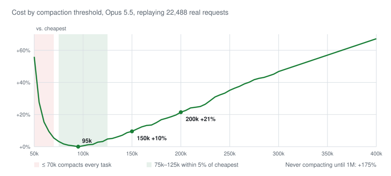

# Why compact at 150k–200k

[Back to README](../README.md)

**Bottom line**: the cheapest point is not the best one. I compact at **150k–200k**: 10%–21% more than the cheapest point, but 57%–72% fewer compactions, far fewer interruptions, and context still inside the smart zone.

On cost alone, replaying 30 days of my own sessions at Opus 5.5 prices, the cheapest compaction point is around 95k, and anything from 75k to 125k is within 5% of it. Never compacting and running up to 1M costs 175% more.

  

## Prices

Opus 5.5, USD per million tokens ([official pricing](https://platform.claude.com/docs/en/about-claude/pricing)):

| Input | Output | Cache write (5 min) | Cache write (1 hour) | Cache read |
| --- | --- | --- | --- | --- |
| $4 | $20 | $5 | $8 | $0.20 |

Pi uses the 5-minute cache by default, so everything below uses that tier.

## Cost per turn, cost per compaction

**Per turn**: while the cache is warm, old context is billed at the cache-read price ($0.20) and what this turn adds is billed at the cache-write price ($5). If no request is sent for 5 minutes, the cache expires and the whole context is rewritten at $5. That happens on 3.8% of requests in my sessions. So the longer the context, the more each turn costs, and much more when the cache has expired.

**Per compaction**:

1. **Rewriting the cache**: the context left after compacting (median 43k for me) has to be written to the cache again. Compared with reading it from the cache, that costs about $0.21 extra each time.
2. **Re-reading files**: compaction drops detail, so the model often reads files again. I measured context growing 8.4k more than usual over the 20 requests after a compaction, about $0.04.
3. **Writing the summary**: pi-blackhole calls no model, so $0. When billion-context-pi-lean has the main model write the summary, the median is 326 output tokens, about $0.007, which is negligible.

In total, one compaction costs about $0.25.

## The cheapest point

Compact early and you pay the fixed cost of compacting many times; compact late and every turn pays for a long tail of old context. Let:

- $B$: context left after compacting, 43k
- $g$: average context growth per request, 1,922 tokens
- $K$: fixed cost of one compaction, about $0.248
- $h$: average per-turn cost of one token of context: the cache-read price plus the cache-expiry rate × the gap between cache-write and cache-read prices, about $0.384 per million tokens

Over one compaction cycle the average context is about $B + (T-B)/2$, and each request carries $Kg/(T-B)$ of compaction cost. Minimizing the sum:

$$
T^* = B + \sqrt{\frac{2Kg}{h}} = 43\text{k} + \sqrt{\frac{2 \times 0.248 \times 1922}{0.384 \times 10^{-6}}} \approx 93\text{k}
$$

This matches the 95k from the request-by-request replay below.

## Simulating with real sessions

The data is 94 sessions and 22,488 Opus requests from my last 30 days. Each request's context growth, output length and gap since the previous request are replayed as-is; only the compaction point changes. When context reaches it, it drops back to 43k, and every request is billed by the rules above.

| Compaction point | Per 1,000 requests | vs. cheapest | Requests per compaction | Tasks per compaction |
| --- | --- | --- | --- | --- |
| 60k | $72.78 | +15.4% | 8 | 1.0 |
| 70k | $66.49 | +5.4% | 13 | 1.5 |
| 80k | $64.15 | +1.7% | 18 | 2.0 |
| **95k** | **$63.07** | **lowest** | **26** | **2.9** |
| 120k | $65.09 | +3.2% | 40 | 4.5 |
| 150k | $69.09 | +9.5% | 60 | 6.8 |
| 200k | $76.61 | +21.5% | 94 | 10.7 |
| 300k | $92.57 | +46.8% | 180 | 20.5 |
| 1M | $173.53 | +175.1% | 1730 | 197 |

A "task" runs from one message I send until the model finishes and waits for my next message.

### When compaction gets frequent

At **70k or below**, compaction happens at least once every 1.5 tasks, and at 60k almost every task.

The median task adds 6.5k of context, but the p90 adds 32.6k. Starting from 43k after a compaction, a large task ends around 75k. Set the point below that and large tasks get compacted halfway through: the model loses details it just read and has to read them again. That is why the cost curve shoots up below 70k.

### Does the answer change with other assumptions?

| Scenario | Cheapest point | Within 5% | 200k vs. cheapest |
| --- | --- | --- | --- |
| Baseline (43k after compacting) | 95k | 75k–125k | +21.5% |
| Only 30k left after compacting | 70k | 55k–105k | +31.3% |
| 60k left after compacting | 115k | 95k–165k | +11.3% |
| Main model writes the summary, p90 of 935 tokens | 95k | 75k–130k | +20.4% |
| No re-reading after compaction | 90k | 70k–115k | +25.2% |
| Cache never expires | 110k | 85k–170k | +8.7% |
| Cache read at 0.1× input price (common for other models) | 80k | 65k–110k | +32.3% |

The cheapest point stays between 70k and 115k, and 200k always costs more. What moves it most is how much is left after compacting: the more is left, the more each compaction costs, and the later the cheapest point.

## How to choose

The cheapest point is not the best one. The more often you compact, the more often the model loses details it just read, has to re-read files or have you explain things again, and gets interrupted mid-task. Luckily the curve rises slowly to the right of its minimum: moving from 95k to 150k costs only 9.5% more. So I settle on 150k–200k, between cost and compaction frequency:

| Compaction point | vs. cheapest | How often it compacts |
| --- | --- | --- |
| 95k (cheapest) | — | every 26 requests, about 3 tasks |
| 150k | +9.5% | every 60 requests, about 7 tasks |
| 200k | +21.5% | every 94 requests, about 11 tasks |

Two limits:

- **Don't go past 300k**: it costs almost half again as much, and context rot starts to show.
- **Don't go below 70k**: large tasks get compacted halfway through, which costs more and works worse.

If cost is all you care about, set 100k–120k.

## Limitations

- This is a replay against the price list, not an actual bill. Context size per request is `input + cacheRead + cacheWrite`.
- It assumes per-request context growth does not depend on the compaction point, apart from the extra re-reading after a compaction.
- It counts cost only and puts no price on quality.
- It ignores pi-blackhole's cheap background model and the 1-hour cache tier.
- The data reflects one person's habits. Your context after compacting, growth per request and idle gaps will differ; plug them into the formula above to find your own point.
