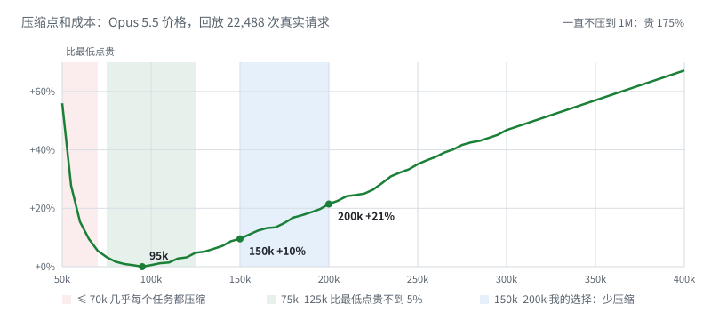

# 上下文压到多大最省钱

[返回 README](../README.zh-CN.md)

**结论**：按 Opus 5.5 的价格，回放我自己 30 天的真实会话，最省钱的压缩点在 **95k 左右**，75k–125k 都只比最低点贵不到 5%。压缩点设在 200k，大约贵 21%；一直不压、跑满 1M，要贵 175%。

所以 200k 不是最省钱的点，而是上限：再往上，成本涨得很快。我仍然用 200k 左右，是拿约两成成本换更少的压缩次数，原因见[怎么选](#怎么选)。

  

## 价格

Opus 5.5，单位是美元 / 百万 token（[官方价格](https://platform.claude.com/docs/en/about-claude/pricing)）：

| 输入 | 输出 | 写缓存（5 分钟） | 写缓存（1 小时） | 读缓存 |
| --- | --- | --- | --- | --- |
| $4 | $20 | $5 | $8 | $0.20 |

Pi 默认用 5 分钟缓存，下面都按这一档算。

## 每轮多少钱，压一次多少钱

**每轮**：缓存还在时，旧上下文按读缓存的价格算（$0.20），这一轮新加的内容按写缓存的价格算（$5）。超过 5 分钟没发请求，缓存过期，整个上下文要按 $5 重新写一遍。我的会话里有 3.8% 的请求属于这种情况。所以上下文越长，每轮越贵；赶上缓存过期，更贵。

**压一次**：

1. **重写缓存**：压缩后剩下的上下文（我的中位数是 43k）要重新写缓存。和继续读缓存相比，每次多花约 $0.21。
2. **重新读文件**：压缩会丢掉细节，模型往往要把文件再读一遍。我实测压缩后 20 次请求里，上下文比平时多涨 8.4k，约 $0.04。
3. **写摘要**：pi-blackhole 不调用模型，为 0。billion-context-pi-lean 由主模型写摘要时，中位数 326 个输出 token，约 $0.007，可以忽略。

加起来，压一次大约 $0.25。

## 最省钱的点

压得早，压缩的固定成本要付很多次；压得晚，每轮都要为一长串旧上下文付钱。设：

- $B$：压缩后剩下的上下文，43k
- $g$：每次请求上下文平均涨多少，1,922 token
- $K$：压一次的固定成本，约 $0.248
- $h$：每 1 token 上下文每轮的平均成本：读缓存价，加上缓存过期概率 × 写缓存和读缓存的差价，约 $0.384 / 百万 token

一轮压缩周期里，平均上下文约为 $B + (T-B)/2$，每次请求分摊 $Kg/(T-B)$ 的压缩成本。两者相加，求最小值：

$$
T^* = B + \sqrt{\frac{2Kg}{h}} = 43\text{k} + \sqrt{\frac{2 \times 0.248 \times 1922}{0.384 \times 10^{-6}}} \approx 93\text{k}
$$

和下面逐条回放算出的 95k 基本一致。

## 拿真实会话模拟

数据来自我最近 30 天的 94 个会话、22,488 次 Opus 请求。每次请求的上下文增量、输出长度和请求间隔都按原样回放，只换压缩点：上下文一到压缩点就压回 43k，然后按上面的规则计费。

| 压缩点 | 每千次请求 | 比最低点 | 每多少次请求压一次 | 每多少个任务压一次 |
| --- | --- | --- | --- | --- |
| 60k | $72.78 | +15.4% | 8 | 1.0 |
| 70k | $66.49 | +5.4% | 13 | 1.5 |
| 80k | $64.15 | +1.7% | 18 | 2.0 |
| **95k** | **$63.07** | **最低** | **26** | **2.9** |
| 120k | $65.09 | +3.2% | 40 | 4.5 |
| 150k | $69.09 | +9.5% | 60 | 6.8 |
| 200k | $76.61 | +21.5% | 94 | 10.7 |
| 300k | $92.57 | +46.8% | 180 | 20.5 |
| 1M | $173.53 | +175.1% | 1730 | 197 |

“任务”指我发一条消息，到模型做完、等我下一条消息为止。

### 什么时候会频繁压缩

压缩点在 **70k 及以下**，平均不到 1.5 个任务就压一次，60k 基本每个任务都要压。

原因是我一个任务的上下文增量中位数是 6.5k，但 p90 有 32.6k。压缩后从 43k 起步，大任务做完要到 75k 左右。压缩点低于这个数，大任务做到一半就会被压缩，模型丢掉刚读的细节，只好重读。成本曲线在 70k 以下陡升，就是这个原因。

### 换个假设，结论变不变

| 场景 | 最省钱的点 | 贵不到 5% 的区间 | 200k 比最低点 |
| --- | --- | --- | --- |
| 基准（压缩后 43k） | 95k | 75k–125k | +21.5% |
| 压缩后只剩 30k | 70k | 55k–105k | +31.3% |
| 压缩后剩 60k | 115k | 95k–165k | +11.3% |
| 主模型写摘要，按 p90 的 935 token 算 | 95k | 75k–130k | +20.4% |
| 不算压缩后重读文件 | 90k | 70k–115k | +25.2% |
| 缓存从不过期 | 110k | 85k–170k | +8.7% |
| 读缓存按输入价的 0.1 倍算（很多模型是这个比例） | 80k | 65k–110k | +32.3% |

最省钱的点一直在 70k–115k 之间，200k 始终比最低点贵。影响最大的是压缩后剩多少：剩得越多，压一次越贵，最省钱的点就越靠后。

## 怎么选

成本曲线的最低点附近很平，往右涨得比往左慢，所以压缩点宁可设大一点，也别设太小。

- **只看成本**：设 100k–120k。
- **我的选择是 200k 左右**：每千次请求多花约 $13，换来压缩次数少到四分之一（每 94 次请求压一次，最低点是 26 次）。每次压缩都会丢细节，打断正在做的事；而且 200k 仍在 smart zone 里。
- **别超过 300k**：成本贵近一半，上下文也开始出现 context rot。
- **别低于 70k**：大任务会在半路被压缩，既不省钱，效果也差。

## 局限

- 这是按价格表回放算的，不是实际账单。上下文大小用的是每次请求的 `input + cacheRead + cacheWrite`。
- 假设每次请求的上下文增量和压缩点无关，只把压缩后多出来的重读算了进去。
- 只算了成本，没有把效果折算成钱。
- 没算 pi-blackhole 后台便宜模型的花费，也没算 1 小时缓存这一档。
- 数据是我一个人的使用习惯。你的压缩后上下文大小、每次请求增量和空闲间隔不一样，代入上面的公式，就能算出自己的点。
